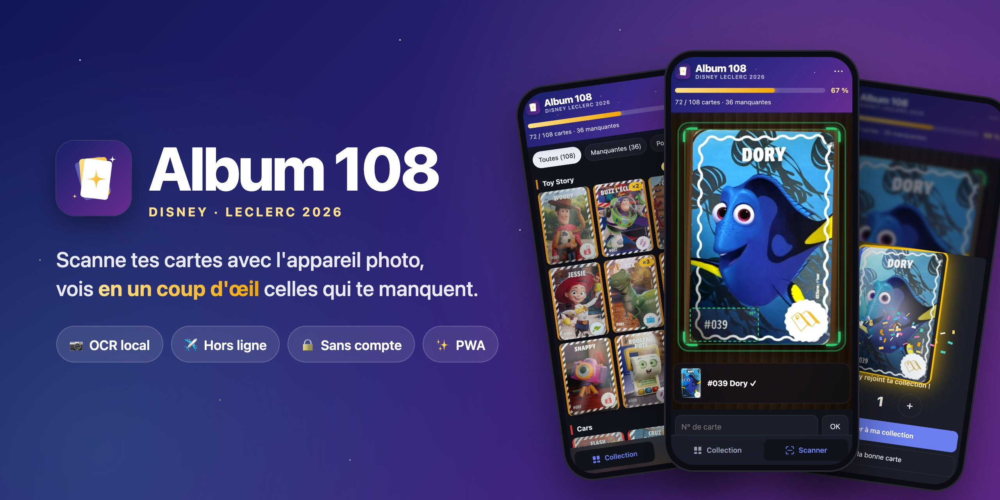
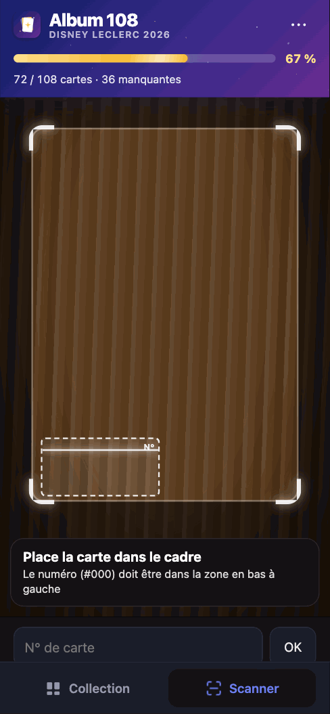
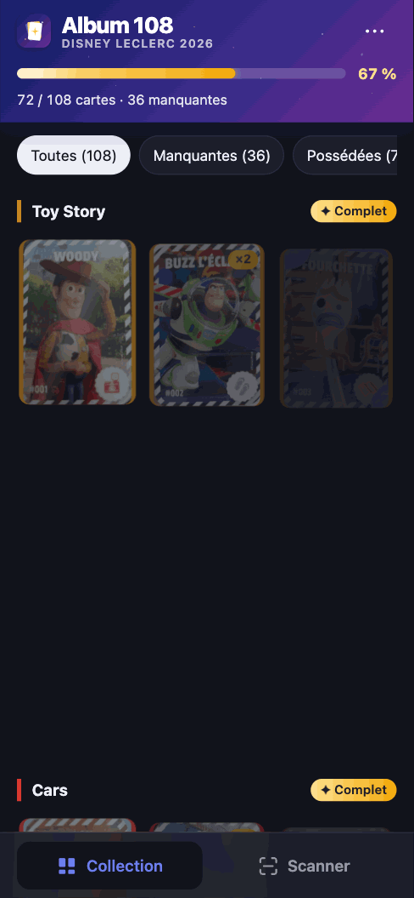
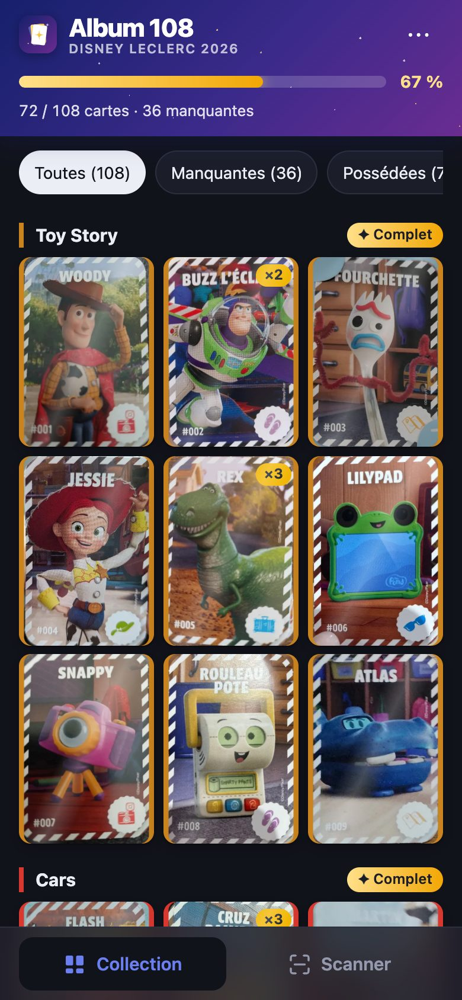
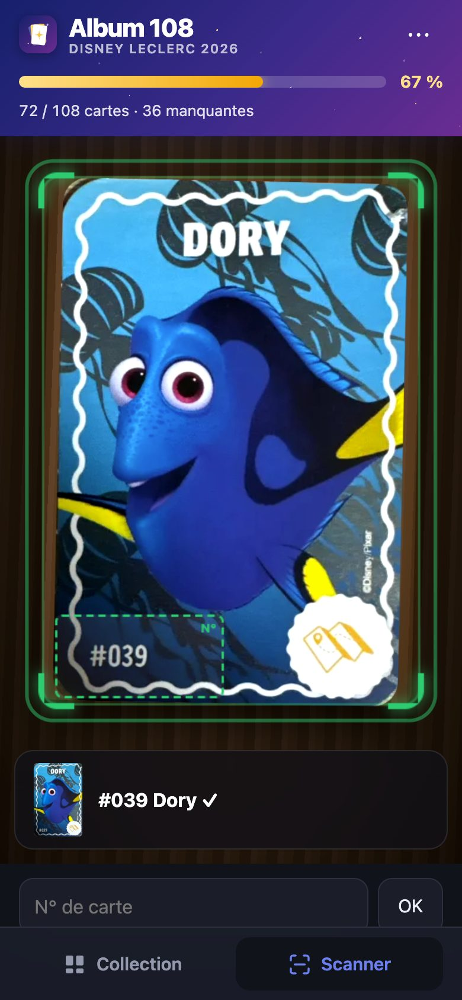
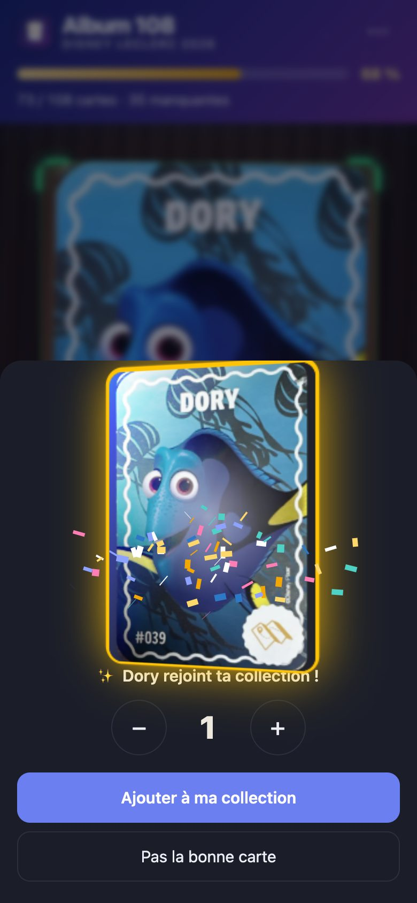
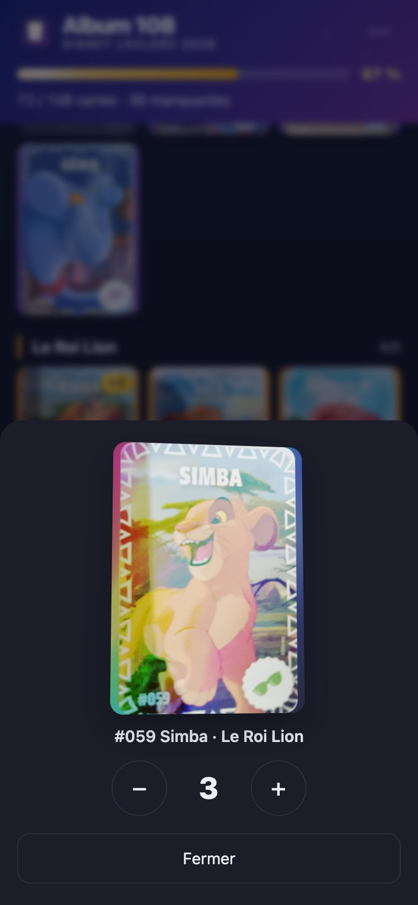
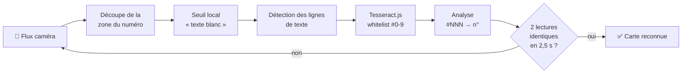

<p align="center">
  
</p>

<p align="center">
  <a href="https://cicoub13.github.io/album-108/"><b>✨ Essayer sur ton téléphone →</b></a>
</p>

<p align="center">
  <a href="https://github.com/cicoub13/album-108/actions/workflows/deploy.yml"></a>
  
  
  
  
  <a href="LICENSE"></a>
</p>

---

**Album 108** est une application web mobile pour suivre la collection des **108 cartes Disney E.Leclerc 2026**.
Tu poses la carte devant l'appareil photo, l'app lit son numéro, et ta collection se met à jour.
Tout se passe **sur le téléphone** : pas de compte, pas de serveur, et ça marche hors ligne.

<table>
  <tr>
    <td align="center" width="50%">
      <br />
      <sub><b>Scan</b> : le numéro <code>#039</code> est lu par l'OCR, confirmé, puis la carte se révèle.</sub>
    </td>
    <td align="center" width="50%">
      <br />
      <sub><b>Collection</b> : filtres animés et carte holographique qui suit le doigt.</sub>
    </td>
  </tr>
</table>

> Le GIF de scan n'est pas un montage : il a été enregistré dans Chrome avec une **fausse caméra** qui filme
> une vraie carte, et c'est le vrai moteur OCR de l'app qui reconnaît le numéro. Tous les visuels de ce README
> (captures, GIFs, bannière, icônes) sont régénérés par une seule commande : `npm run demo`.

## Fonctionnalités

|  |  |
|---|---|
| 📷 **Scan instantané** | Le numéro imprimé en bas à gauche (`#039`) est lu en continu par la caméra. Le cadre change de couleur à chaque étape : recherche, numéro repéré, vérification, carte reconnue. |
| 📚 **Collection par film** | Les 108 cartes rangées en 21 films, avec les filtres *Toutes / Manquantes / Possédées / Doublons*. Une série complète reçoit son badge doré. |
| 🔁 **Doublons** | Un compteur d'exemplaires par carte, pratique pour préparer les échanges dans la cour de récré. |
| ✨ **Effets** | Carte holographique, confettis, sons et vibration à chaque nouvelle carte, célébration quand une série est complète. Tout se coupe si le système demande de réduire les animations (`prefers-reduced-motion`). |
| 💾 **Tes données restent chez toi** | La collection reste dans le navigateur. Tu peux l'exporter et la réimporter en JSON depuis le menu ⋯. |
| 📲 **Installable** | C'est une PWA : *Ajouter à l'écran d'accueil*, et elle fonctionne hors ligne après la première visite. |

<p align="center">
  
  
  
  
</p>

## Sous le capot

L'enjeu : lire de façon fiable un petit numéro blanc (`#039`) sur un visuel chargé, avec la caméra d'un
téléphone d'entrée de gamme, **sans envoyer d'image à un serveur**.



- **Prétraitement fait main** (`src/preprocess.ts`) : seuillage local qui ne garde que les pixels nettement
  plus clairs que leur voisinage, puis regroupement en composantes connexes pour ne passer à l'OCR que les
  lignes qui ont la forme d'un `#NNN`. Le code est pur : il tourne aussi sous Node pour les tests et le banc.
- **Vote sur fenêtre glissante** (`src/scanner.ts`) : une lecture isolée peut se tromper, deux lectures
  concordantes en 2,5 s beaucoup plus rarement. La carte confirmée est ensuite ignorée tant qu'elle reste
  devant l'objectif.
- **Banc de précision** (`npm run bench`) : rejoue le pipeline sur les 108 visuels, avec des cadrages décalés
  de ±3 %, pour mesurer chaque changement (environ 66 % de bonnes lectures par image et 5 % de fausses ;
  le vote sert à filtrer ces dernières).
- **Pièges mobiles contournés** : `ctx.filter` est peu fiable sur Safari iOS (les pixels sont traités à la
  main), la caméra exige HTTPS même en dev, et les visuels distants sans CORS sont affichables mais illisibles
  dans un canvas.
- **Effets sans dépendance** : confettis en canvas, sons synthétisés en Web Audio (aucun fichier audio),
  reflets holographiques en CSS pur. Le JS complet pèse ~17 ko gzip, hors moteur OCR chargé à la demande.

## Développement

Prérequis : Node.js ≥ 24.

```bash
npm install
npm run dev     # https://<ip-de-la-machine>:5173 depuis le téléphone (même Wi-Fi)
npm test        # tests unitaires (vitest)
npm run build   # build de production dans dist/
npm run bench   # précision de l'OCR sur les 108 visuels (macOS : utilise `sips`)
npm run demo    # régénère captures, GIFs, bannière et icônes (Chrome requis)
```

Le serveur de dev est en HTTPS auto-signé (la caméra exige un contexte sécurisé) : accepte
l'avertissement de certificat sur le téléphone.

<details>
<summary><b>Déployer ta propre copie sur GitHub Pages</b></summary>

Le workflow [`.github/workflows/deploy.yml`](.github/workflows/deploy.yml) teste, construit et publie
le site à chaque push sur `main`.

1. *Settings → Pages → Build and deployment → Source* : **GitHub Actions**.
2. Pousser sur `main` (ou lancer le workflow à la main depuis l'onglet *Actions*).
3. Le site est publié sur `https://<utilisateur>.github.io/<repo>/`.

</details>

## Sources et crédits

- Liste des cartes : [collexstash.com](https://www.collexstash.com/fr/collections/cards/cartes-disney-leclerc-2026).
- Les visuels des cartes sont chargés depuis les serveurs de collexstash ; ils ne sont pas inclus dans ce dépôt
  (hormis dans les captures d'écran de ce README).
- Code sous [licence MIT](LICENSE).
- Projet personnel non officiel, sans lien avec Disney, Pixar ou E.Leclerc. Les personnages et visuels
  sont la propriété de leurs ayants droit.
